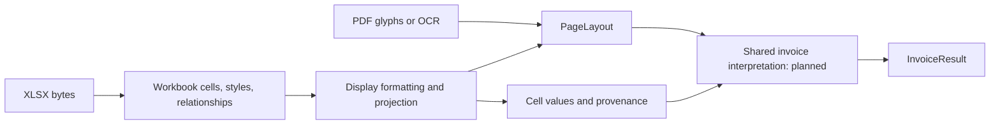

**Astra's preliminary thoughts — 2026-11-04**

I would proceed with the spreadsheet track, beginning with a bounded workbook reader and a layout adapter. The direction in `notes/astra-read.md` is sound: synchronous ZIP reads over an in-memory buffer, cached formula results, and shared invoice interpretation. The part I would settle first is the intermediate representation. A workbook already supplies cell identity, typed values, and structural relationships; projecting it straight into text boxes would discard useful evidence before extraction begins.

I read the full discussion and the supplied `ocr/__test__/fixtures/private/workbook.rs.md`, followed the relevant Rust paths under `src`, and checked the spreadsheet plan in `notes/2026-11-03/1037.md`. The gitignored reference was directly readable, and `git check-ignore` confirms it is ignored. No access setting needs to change for this session. This is a source review and design note; I have not implemented the reader, run the Rust suite, rebuilt WASI, or re-measured the private workbook corpus. The corpus sizes below come from the existing survey. Specific format details were cross-checked against the linked Microsoft documentation.

**The current implementation gives us a good layout foundation, with an invoice integration point still to build.** These are the code boundaries that matter most:

| Existing code                                                                                                                                                                                                                                           | What it establishes for this work                                                                                                                                                                                                                                                 |
| ------------------------------------------------------------------------------------------------------------------------------------------------------------------------------------------------------------------------------------------------------- | --------------------------------------------------------------------------------------------------------------------------------------------------------------------------------------------------------------------------------------------------------------------------------- |
| [src/lib.rs](../../src/lib.rs), `load_doc`, `ExtractLayoutTask`, `ExtractInvoiceTask`, `PdfDown`                                                                                                                                                        | Entry points receive complete buffers. Async tasks move owned bytes into `compute`. `PdfDown` owns an `Arc<lopdf::Document>` and loads PDFs in its constructor. Standalone XLSX functions fit without changing that class.                                                        |
| [src/types/layout.rs](../../src/types/layout.rs)                                                                                                                                                                                                        | `TextWord` has text, geometry, font metadata, and optional OCR confidence. It has no typed value or cell identity. `PageLayout` has no sheet field yet, and `TextSource` has no `Spreadsheet` variant.                                                                            |
| [src/core/layout/mod.rs](../../src/core/layout/mod.rs), `native_layout`                                                                                                                                                                                 | Native PDF extraction produces raw words and font metadata, then builds public words and lines. Page dimensions and coordinates follow an explicit PDF frame.                                                                                                                     |
| [src/core/layout/words.rs](../../src/core/layout/words.rs), `words_to_lines`                                                                                                                                                                            | Line grouping uses baselines, half the median word height as tolerance, and vertical overlap. It sorts and rebuilds the word array, then assigns line indices and contiguous slices.                                                                                              |
| [src/core/layout/interpreter.rs](../../src/core/layout/interpreter.rs), [fonts.rs](../../src/core/layout/fonts.rs), [standard14.rs](../../src/core/layout/standard14.rs), [tounicode.rs](../../src/core/layout/tounicode.rs)                            | Native boxes come from glyph advances, font metrics, and transformations. The available fallback metrics cover standard PDF font families; they do not establish accurate Excel font measurement.                                                                                 |
| [src/core/ocr.rs](../../src/core/ocr.rs), `finish_ocr_layout`, `merge_native_and_ocr`                                                                                                                                                                   | A second producer already feeds the shared word/line representation. OCR confidence describes recognition. Page `source` describes the cascade tier, including hybrid pages.                                                                                                      |
| [src/core/invoice/mod.rs](../../src/core/invoice/mod.rs), `extract_invoice`                                                                                                                                                                             | Currently accepts a PDF document, tries embedded XML, and otherwise returns empty fields with `InvoiceSource::None`. There is no layout-based anchor, amount, table, or totals engine to call yet.                                                                                |
| [src/core/invoice/einvoice.rs](../../src/core/invoice/einvoice.rs), [src/types/invoice.rs](../../src/types/invoice.rs)                                                                                                                                  | The result vocabulary already distinguishes normalized values from source text. XML mapping uses `roxmltree`; its private money/date helpers assume structured invoice input and are unsuitable as general spreadsheet formatters.                                                |
| [src/core/forms.rs](../../src/core/forms.rs), [src/types/forms.rs](../../src/types/forms.rs)                                                                                                                                                            | The code already distinguishes logical field identity from its visual placements and preserves unplaced values. That is a useful precedent for cells versus projected text.                                                                                                       |
| [src/core/document.rs](../../src/core/document.rs), [text.rs](../../src/core/text.rs), [meta.rs](../../src/core/meta.rs), [images.rs](../../src/core/images.rs), [render.rs](../../src/core/render.rs), [attachments.rs](../../src/core/attachments.rs) | These supply PDF aggregation, plain text, page geometry, rasters, rendering, and embedded payloads. The spreadsheet path belongs beside them. In particular, `pdf_document` does not currently aggregate `PageLayout`, and plain-text header/footer detection is a separate path. |

Consequently, “the same invoice engine runs unchanged” is an architectural objective. We can build and validate workbook parsing and projection before phase IV. Completing `extractInvoiceFromXlsx` requires the shared semantic engine. I would introduce its internal entry point over layouts plus optional structured evidence, with the PDF orchestrator retaining embedded-XML preference.

**Keep a cell model before choosing the public typed-value API.** My answer to Fable's closing question is yes: retain typed values beside display text internally from the first implementation. I would avoid immediately adding an unqualified `value?: number | string | boolean` to every `TextWord`.

A cell can contain several words, several lines, or no visible text. One merge can cover several rows. Repeated print titles can place the same cell on multiple pages. None of these relationships is naturally one cell to one word. A useful internal cell record would retain:

- Sheet identity and name, row/column address, merge ownership, and effective style reference.
- The original value spelling and an explicit kind: string, number, boolean, error, date/time interpretation, or blank. Keep the numeric source string even when also parsing an `f64`.
- Formula metadata and cache presence, distinguishing a missing cache from an empty string, zero, or an error result.
- Display text, the format that produced it, and whether formatting was supported or approximated.
- The cell rectangle, projected text fragments, and stable links between them.

That last link must survive `words_to_lines`, which reorders its input and creates fresh `TextWord`s. Attaching metadata by input vector position and assuming it still matches the returned words would be a bug. Carry an identity through the intermediate representation or explicitly return the mapping. Keep this machinery internal until its public shape earns its place.

There is also a semantic distinction between stored and displayed numbers. An invented cell can store `1234.567` while displaying `1,234.57`; a percentage can store `0.075` while displaying `7.50%`; an identifier can store `123` while displaying `00123`. The invoice engine needs a stated policy for each role. It must not silently substitute an unrounded stored number for a displayed billed amount, erase identifier padding, or confuse a percentage ratio with percentage points. `MoneyField` already says source text is authoritative when cents matter. Preserve enough evidence to make the eventual choice auditable.

Typed data reduces ambiguity in reading the cell. It does not establish that the cell is the invoice total rather than a subtotal, rate, or balance. Spreadsheet fields should therefore still receive confidence for their semantic association; the XML path's blanket `1.0` should not be inherited merely because a numeric cell parsed successfully. Leave `TextWord.confidence` absent for spreadsheet words: its current meaning is OCR recognition confidence, so projection quality needs separate diagnostics.

**A merged rectangle is useful structure, but its whole area is a poor substitute for a text box.** The existing clustering code expects word-height boxes and baselines. Feeding it a tall, multirow merge changes the median height and overlap behavior; a wrapped paragraph stored as one word also cannot behave like its PDF counterpart.

I would retain the full cell/merge rectangle as structural evidence, then emit text fragments with explicit baselines and estimated text extents. Preserve explicit line breaks first. Apply horizontal and vertical alignment within the cell, and make any inferred wrapping or fallback font measurement observable. If a first version deliberately emits whole-cell tokens, document that choice and test a cell-aware grouping adapter; do not simply assume today's word clusterer will produce equivalent lines.

Column widths need special care. SpreadsheetML defines them using the maximum digit width of the Normal style's font, with padding and truncation rules. A constant “characters times points” conversion is an approximation. Row heights use points. The existing standard-14 tables cannot supply exact Calibri or Aptos metrics. For the initial extractor, a deterministic approximation may be sufficient, provided column boundaries remain ordered and its limitations are explicit. [Microsoft's column-width definition](https://learn.microsoft.com/en-us/dotnet/api/documentformat.openxml.spreadsheet.column?view=openxml-3.0.1), [row and column units](https://support.microsoft.com/en-us/excel/change-the-column-width-and-row-height).

For a synthetic page of height `H`, convert a top-origin cell rectangle with top `t` and bottom `b` to `y0 = H - b`, `y1 = H - t`. Compute this in the page's selected range and coordinate frame. Hidden rows and columns should contribute zero visual extent to a visible-sheet projection; retain their original addresses in the workbook model. A zero-width hidden column means boundaries are nondecreasing, rather than necessarily strictly increasing.

The accepted `Spreadsheet` source and optional `sheet` field from decision 12.2 should land with the feature. Also define globally unique output page numbers across sheets and a way to recover the source cell from an extracted field. `FieldSpan` currently carries only page and coordinates. Its documentation, the font-field comments, and `TextSource`'s OCR-tier description need to accommodate synthetic spreadsheet pages. `InvoiceSource` needs its own spreadsheet representation when invoice extraction lands; extending `TextSource` alone is insufficient.

**The supplied reader is a useful checklist, with several implementation details I would deliberately change.** These observations apply to the supplied file, not to an independently checked upstream release. They come from source inspection, not executed regression tests.

| Location in `workbook.rs.md`                                           | Observation and consequence                                                                                                                                                                                                                                                                                                                                                                                                                                                                                        |
| ---------------------------------------------------------------------- | ------------------------------------------------------------------------------------------------------------------------------------------------------------------------------------------------------------------------------------------------------------------------------------------------------------------------------------------------------------------------------------------------------------------------------------------------------------------------------------------------------------------ |
| `parse_styles`, around line 363                                        | It records `xf` only for `Event::Empty`. A normal `<xf ...><alignment .../></xf>` is skipped. That removes a style slot, potentially shifting every subsequent cell-style lookup. Count each direct `cellXfs/xf` child regardless of whether it has children. `xf` can contain alignment and protection elements. [Microsoft's cell-format definition](https://learn.microsoft.com/en-us/dotnet/api/documentformat.openxml.spreadsheet.cellformat?view=openxml-2.8.1).                                             |
| `parse_shared_strings` and `parse_sheet_xml`, around lines 223 and 477 | Global `trim_text(true)` risks fusing rich-text runs such as `"Invoice "` and `"Total"`. Text collection also needs to distinguish actual string runs from phonetic annotations. An empty `<si/>` currently fails to occupy a shared-string slot. Preserve indexed slots and meaningful whitespace.                                                                                                                                                                                                                |
| `custom_shape` and `Styles::shape_of`, around lines 287–319            | Stripping all bracket sections discards elapsed-time tokens. The three-way Number/Date/DateTime classification cannot faithfully represent durations or time-only values. Built-in 46 is `[h]:mm:ss`; the supplied code classifies it as DateTime. [Microsoft's number-format definitions](https://learn.microsoft.com/en-us/dotnet/api/documentformat.openxml.spreadsheet.numberingformat).                                                                                                                       |
| `serial_to_date`, around line 700                                      | In the 1900 system its arithmetic maps both serial 60 and serial 61 to the same real date, March 1. Handle the fictitious leap day explicitly: retain the serial/display anomaly and decline to invent a valid ISO calendar date for it. Date-only conversion should also avoid the unconditional near-midnight time-rounding carry in this function. [Microsoft's explanation of the 1900 compatibility behavior](https://learn.microsoft.com/en-US/office/troubleshoot/excel/wrongly-assumes-1900-is-leap-year). |
| `sheet_path`, around line 208                                          | Concatenating `xl/` and falling back to sheet position can associate the wrong content with a sheet name when relationships are damaged. Resolve package relationships and relative part targets explicitly; report a missing mapping. Make any repair heuristic an observable compatibility choice.                                                                                                                                                                                                               |
| `parse_workbook` and `OpenCell::finish`, around lines 77 and 435       | `.ok()` on optional-part reads treats decompression/read failures like absence; out-of-range shared-string indices become empty strings. Missing optional content, corrupted content, and invalid references need distinct outcomes.                                                                                                                                                                                                                                                                               |
| `read_part` and reference/range parsing, around lines 128 and 644      | Reads grow an unbounded string, and reference parsing does not enforce worksheet bounds. Limits must cover actual decompressed bytes and downstream allocations, including sparse far-away cells and huge declared ranges.                                                                                                                                                                                                                                                                                         |

I agree with retaining cached formula values and handling the two date systems. I would preserve the formula and any recalculation-related warning separately, never present the expression as a calculated amount, and never equate “cached” with “fresh.” Shared-formula followers also need cache handling even when their formula text is absent. Missing cached results should remain unavailable rather than becoming zero.

**Formatting is a substantive part of this feature.** Raw numeric text plus an ISO date converter will not satisfy the proposed PDF comparison. Start with an explicit supported subset: ordinary decimals, grouping, signs and negative parentheses, common currency/accounting formats, percentages, zero-padding, and common dates/times. Add elapsed durations explicitly if encountered. Dates have both a display representation and a normalized interpretation; emitting ISO text everywhere loses the original display convention.

Parse format syntax rather than looking for letters in a stripped string. Section choice, literals, escapes, scaling, and contextual month/minute tokens need deliberate treatment. An unsupported format should preserve the raw value and format code and report a fallback. Locale-dependent output needs a deterministic rule; it should not vary with the host machine. Full Excel display parity, including width-driven General formatting and overflow, can be a later capability. [Microsoft's number-format documentation](https://learn.microsoft.com/en-us/dotnet/api/documentformat.openxml.spreadsheet.numberingformat).

**I would distinguish logical sheet layout from print layout in the contract.** The survey reports small worksheets with many merges, which makes a logical projection tractable. A printed workbook page additionally depends on paper size, margins, orientation, scale/fit settings, page order, breaks, and repeated content. `pageSetup` explicitly includes separate fit-to-width/height controls and print order, so reading break lists alone cannot reproduce pagination. [Microsoft's page-setup definition](https://learn.microsoft.com/en-us/dotnet/api/documentformat.openxml.spreadsheet.pagesetup?view=openxml-3.0.1).

My first milestone would produce deterministic logical pages for selected visible sheets, honor supported print-area selection, and retain print metadata for the next stage. Unsupported print-area expressions or pagination features should be reported. If exact printed-page behavior is required immediately, it should be sized as additional work before claiming parity with PDF twins. This is a proposed refinement to the earlier plan, not a decision already taken.

Visibility and selection also need explicit defaults. I would default to visible sheets in workbook order, let a caller select an otherwise hidden sheet deliberately, and retain hidden data in the parsed model while excluding it from the visible projection. Used-range computation should be sparse and content-aware; a styled empty cell at a distant address should not force a giant dense grid. Empty rows can still carry layout height, and empty styled cells can still matter to borders and merges, so omitting empty text does not mean discarding all empty-cell structure.

**The dependency discussion is mostly settled by the current architecture.** `Cursor<&[u8]>` plus synchronous `zip` matches the buffer-based APIs and the existing `AsyncTask::compute` pattern. Introducing async ZIP I/O would not remove the CPU work of inflation, XML parsing, or formatting. Implement a native async wrapper by following the task pattern already in `src/lib.rs`.

The current manifest disables ZIP defaults and enables `deflate`. The installed `zip` 9.3.0 manifest confirms that this feature selects `deflate-flate2-zlib-rs` and also `deflate-zopfli`. The latter is worth revisiting for dependency/build size in a read-focused package, but it is not a reason to delay the feature. Fable's earlier build results remain historical evidence; this review did not rerun them.

I would initially use the existing `roxmltree`, parsing one bounded worksheet part at a time into owned records. The survey's roughly 672–1,460 cells per workbook does not justify adding a streaming parser merely for anticipated scale. Keep the parser behind a module boundary so a later streaming implementation can preserve the same model. The installed `roxmltree` 0.21.2 exposes `ParsingOptions.nodes_limit`; its default is effectively unrestricted, while DTD parsing defaults off. Set the node limit deliberately and keep external entity resolution disabled.

Bound compressed input, indexed entries, decompressed bytes per part and in aggregate, cells, shared strings, merges, and projected output. Enforce actual read limits rather than trusting ZIP header sizes. Entry-count checks performed after `ZipArchive::new` are not a pre-allocation bound on archive indexing. Keep package targets inside the package and do not fetch external relationships. These constraints belong in the reader's contract and fixtures.

For format detection, ZIP magic and the presence of `[Content_Types].xml` are insufficient to identify an XLSX: other Office packages share those features. Follow the package's workbook relationship and validate its content type. Resolve worksheet, style, and shared-string parts through their relationships instead of assuming conventional filenames. Decide explicitly whether Strict OOXML is supported and how unsupported sheet kinds, macro-enabled workbooks, and encrypted containers are reported. [Microsoft's SpreadsheetML package overview](https://learn.microsoft.com/en-us/office/open-xml/spreadsheet/structure-of-a-spreadsheetml-document).

**PDF twins are valuable differential evidence, but I would add independent expectations.** The survey reports 17 workbooks and 64 PDFs from the same form family. That does not by itself establish which files contain identical revisions and values. First establish actual pairs or create controlled workbook/PDF exports with invented data.

Even for a genuine pair, exact `TextLine` array equality is too strict as the first acceptance gate. Wrapping, print scaling, repeated headers, glyph segmentation, and the current PDF reader can all change line boundaries. Compare displayed values and label-to-value associations first, then reading order, row/column relationships, and supported page geometry with stated tolerances. Treat disagreements as evidence to inspect. Two paths agreeing does not independently prove both correct.

I would use three kinds of checks:

1. Small public OOXML fixtures with explicit expected cells, display strings, types, and diagnostics. Include nested `xf` records, rich-text spacing, empty shared-string slots, missing versus empty formula caches, zero-padding, accounting negatives, percentages, both date systems, serials 59/60/61, and elapsed time.
2. Projection fixtures with multirow merges, explicit newlines, alignment, hidden dimensions, non-origin selected ranges, multiple sheets, and sparse distant cells. Check finite ordered boxes, stable source identity, and the `firstWord`/`wordCount`/`word.line` invariants. Resource-limit failures should be explicit and deterministic.
3. Differential PDF comparisons plus representation-invariance checks: equivalent shared/inline strings, renamed relationship IDs and part paths, reordered ZIP entries, and equivalent empty/nonempty XML element spelling should preserve the relevant output.

The current corpus profiler counts XLSX files but only extracts PDFs; `scripts/lib/evaluate.ts` also filters to PDFs. Spreadsheet evaluation therefore needs an actual harness extension. It will not start working automatically when the Rust API appears. Base and OCR package declarations, their type tests, and the WASI exports/build also need coverage when public types are extended.

**The first implementation should settle the data contract through a small complete slice.** I would keep it in `src/core/spreadsheet/`, with separate responsibilities for package access, cell/style parsing, formatting, and projection, plus public types only where needed. The sequence I favor is:

1. Agree on retained cell evidence, synthetic coordinate semantics, source provenance, and the distinction between logical and printed layout.
2. Implement bounded package traversal and a sparse workbook model, with the reference-reader edge cases covered by independent fixtures.
3. Deliver `layoutFromXlsx` and its async counterpart for a synthetic form containing labels, a formatted amount, a cached formula, and a multiline merge. Include the accepted `Spreadsheet`/`sheet` additions and diagnostics.
4. Establish true PDF pairs and evaluate the supported formatting/geometry subset before expanding print fidelity.
5. Connect `extractInvoiceFromXlsx` when the shared layout-based invoice engine exists, passing typed evidence through a documented internal interface.

This lets spreadsheet work advance while the phase-IV reference export is pending. The highest-value early decision is preserving cell semantics through projection. With that in place, the later invoice engine can use both the familiar layout and the stronger evidence already present in a workbook.
